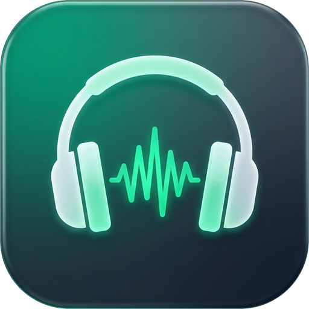

<div align="center">
  
  <h1>AlgerMusicPlayer · Android</h1>
  <p>基于 Kotlin 与 Jetpack Compose 原生构建的 Android 高解析度音乐播放器</p>

  <p>
    <a href="https://github.com/TencenTiM/AlgerMusicPlayer-Android/stargazers"></a>
    <a href="https://github.com/TencenTiM/AlgerMusicPlayer-Android/releases"></a>
    
    
    
    
    <a href="./LICENSE"></a>
  </p>

  <p>
    桌面端姊妹项目：<a href="https://github.com/TencenTiM/AlgerMusicPlayer-WinUI3"><strong>AlgerMusicPlayer · WinUI 3</strong></a>
  </p>
</div>

---

## 📖 项目简介

**AlgerMusicPlayer (Android Edition)** 是基于 **Kotlin + Jetpack Compose + AndroidX Media3 (ExoPlayer)** 纯原生开发的移动端高解析度音乐播放器，与桌面端 [AlgerMusicPlayer-WinUI3](https://github.com/TencenTiM/AlgerMusicPlayer-WinUI3) 同源设计，并针对触控手势、120Hz 高刷动画、实时液态玻璃材质与多平台曲库融合进行了深度移动化重构。

应用无需任何外部后端代理服务，内置纯 Kotlin 加密协议栈与多音源调度引擎，支持 **超清母带 / Hi-Res / 无损 FLAC** 在线播放与下载，同时原生打通 **本地音乐、飞牛 NAS（fnOS）曲库、桌面端远程控制、多套沉浸式播放器样式、桌面与状态栏/息屏歌词小组件**。

---

## ✨ 核心特性

### 🎵 全平台曲库与高解析度音源
- **网易云音乐原生直连**：纯 Kotlin 实现 WEAPI / EAPI 协议，支持扫码、网页与 Cookie 登录；完整覆盖每日推荐、私人 FM、歌单广场、排行榜、歌手/专辑详情、热评互动与 MV 播放。
- **多生态专区融合**：内置 **QQ 音乐**（快捷登录与歌单同步）、**汽水音乐**、**Bilibili（B 站）** 音频流直连与 **第三方音源专区**。
- **高解析度音质与持久化首选音源**：
  - 支持标准 / 极高 / 无损 FLAC / Hi-Res / **超清母带（`jymaster`）** / 高清臻音 / 沉浸环绕声档位切换，提供「默认最高」一键锁定。
  - 支持多平台音源自动解灰、单曲手动换源与 **持久化首选音源记忆**，切歌自动保持你偏好的音源与音质策略。
  - 内置 **落雪（LX Music）自定义音源脚本宿主**，支持导入与管理第三方音源脚本。
- **多线程下载与标签内嵌**：支持按音质下载歌曲至本地，并借助 `TagLib` 自动写入高清专辑封面、元数据与歌词标签。

### 🎨 7 套沉浸式播放器样式与液态玻璃视觉
- **全局实时液态玻璃（Liquid Glass）**：基于 `backdrop` 实时采样底层内容渲染磨砂折射效果，覆盖底部导航胶囊、迷你播放栏、播放器内弹出菜单与功能面板（音源/音质、均衡器、下载、评论、定时关闭）。
- **120Hz 一体化胶囊展开动效**：迷你播放栏到全屏播放页全程 GPU `graphicsLayer` 驱动，零重组掉帧，支持跟手下拉收起。
- **7 套可自定义播放器样式**（支持风格画廊预览与细节开关自定义）：
  - **Apple Music**：1:1 还原 iOS 风格布局与交互——顶部抓手、以封面为锚点的共享缩放、页内实时同步歌词、磨砂玻璃音频输出卡片、页内播放队列（下拉展开历史记录 + 右侧拖拽调整顺序）与实时系统音量条。
  - **经典大封面**：大尺寸圆角封面卡片 + 封面三色动态提取流光背景。
  - **黑胶唱片**：拟真旋转黑胶与唱臂动效。
  - **全屏封面**：沉浸式满屏海报封面。
  - **舞台聚光灯**：动态光束舞台氛围。
  - **极简歌词**：居中大字滚动歌词专注模式。
  - **复古磁带**：双卷轴转动复古卡带外观。

### 🎧 发烧级音频处理与歌词生态
- **Media3 ExoPlayer 音频管线**：支持音频流缓存、断点续播、无级倍速播放、定时停止播放与系统媒体中心（`MediaSession`）完整联动。
- **10 段参量均衡器（EQ）**：内置 `TenBandEqualizerAudioProcessor` 与多种音效预设，实时调音。
- **全场景歌词体验**：
  - 支持 LRC 逐行、YRC 逐字卡拉 OK 高亮、翻译歌词与罗马音同步显示。
  - 支持 **桌面单行/双行透明歌词小组件**、**息屏/锁屏（AOD）歌词开关** 与 **状态栏歌词**。

### 📂 本地音乐、飞牛 NAS 与跨端联动
- **本地音乐扫描与管理**：基于 SAF / MediaStore 扫描本地目录，支持曲目检索、排序与元数据解析。
- **NAS 私有曲库**：内置飞牛 NAS（`fnOS`）原生客户端与封面自动匹配，随时串流家中无损曲库。
- **远程控制桌面端**：内置局域网远程控制模块，手机可直接联动控制桌面版 AlgerMusicPlayer 播放状态。

---

## 🗂️ 项目结构

```text
AlgerMusicPlayer-Android/
├── app/
│   ├── build.gradle.kts                    # 应用模块配置 (compileSdk 36 / targetSdk 35 / minSdk 26)
│   └── src/main/java/com/algermusic/player/
│       ├── data/
│       │   ├── api/                        # 网易云 WEAPI/EAPI、QQ 音乐、B 站、第三方音源服务
│       │   ├── download/                   # 音频下载管理与 TagLib 标签写入
│       │   ├── local/                      # 本地音乐扫描与 DataStore 持久化配置
│       │   ├── lyric/                      # LRC / YRC 逐字 / 翻译 / 罗马音解析服务
│       │   ├── nas/                        # 飞牛 NAS (fnOS) 客户端与封面匹配
│       │   ├── remote/                     # 桌面端远程控制客户端
│       │   └── unblock/                    # 多音源解灰引擎与 LX 音源脚本宿主
│       ├── model/                          # 歌曲、歌词、NAS、播放器样式与全局配置模型
│       ├── player/                         # Media3 ExoPlayer 控制、10 段 EQ、流缓存与状态栏歌词
│       ├── ui/
│       │   ├── components/                 # 液态玻璃组件、底部导航、迷你播放栏与各类功能弹窗
│       │   ├── screens/                    # 主页、播放页、Apple Music 布局、样式画廊、设置等页面
│       │   ├── theme/                      # Material 3 主题与色彩定义
│       │   └── viewmodel/                  # 主业务 ViewModel
│       └── widget/                         # 桌面音乐小组件与透明/AOD 歌词小组件
├── gradle/
│   └── libs.versions.toml                  # 依赖版本目录
├── build.gradle.kts
└── settings.gradle.kts
```

---

## 🚀 构建与运行

### 环境要求
- **Android Studio**：Meerkat / Narwhal 及以上
- **JDK**：17
- **Android SDK**：Compile SDK 36，最低支持 Android 8.0（API 26）

### 1. 克隆仓库
```bash
git clone https://github.com/TencenTiM/AlgerMusicPlayer-Android.git
cd AlgerMusicPlayer-Android
```

### 2. 编译与测试
```bash
# 运行单元测试并构建 Release APK
./gradlew testDebugUnitTest assembleRelease
```

Windows PowerShell：
```powershell
.\gradlew.bat testDebugUnitTest assembleRelease
```

构建产物位于 `app/build/outputs/apk/release/app-release.apk`。

---

## 📄 开源协议与免责声明

- 本项目基于 [MIT License](./LICENSE) 开源，仅供个人学习与技术交流使用。
- 音频资源与版权均归各音乐平台及原版权方所有，请支持正版音乐，切勿用于任何商业或侵权用途。
